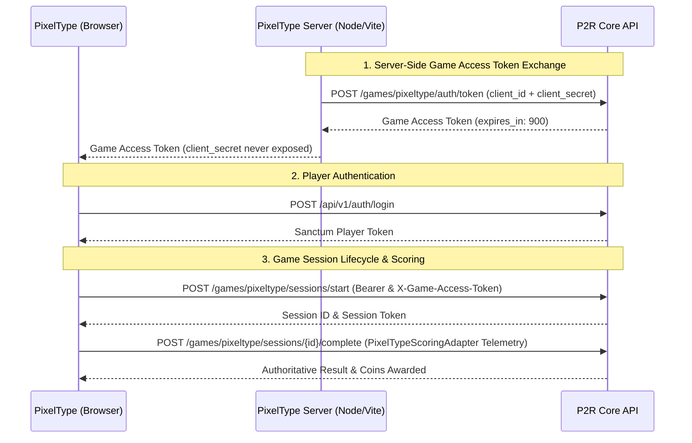

# PixelType — Futuristic Retro-Pixel Typing Game

Standalone cyberpunk/retro-pixel typing game integrated with the Pixel To Reality (P2R) arcade ecosystem.

---

## 1. Responsibilities & Boundaries

- **Typing Engine & Mechanics:** Real-time calculation of Words Per Minute (WPM), typing accuracy, consecutive combo counters, error highlighting, and interactive round progression.
- **Multi-Language Dictionaries:** Built-in typing dictionaries supporting multiple languages and coding modes (Indonesian, English, JavaScript, Python, etc.).
- **Offline Gameplay Mode:** Standalone browser capability with automatic fallback to `localStorage` when offline or unauthenticated.
- **P2R Game Ecosystem Integration:**
  - Player authentication via P2R Sanctum credentials.
  - Game access token exchange mediated through the P2R Panel BFF.
  - Session lifecycle management (`/sessions/start`, `/sessions/complete`) with score and telemetry verification.
  - Live per-game leaderboard synchronization.

---

## 2. Technology Stack

- **Framework & Build:** React 19 (`react: ^19.0.1`, `react-dom: ^19.0.1`) with Vite 8 (`vite: ^8.3.0`)
- **Language:** TypeScript 7 (`typescript: ^7.0.2`)
- **Styling:** Tailwind CSS v4 via `@tailwindcss/vite` (`^4.3.3`)
- **Animations:** Framer Motion & Motion (`framer-motion: ^13.4.0`, `motion: ^12.23.24`)
- **Routing:** React Router DOM 7 (`react-router-dom: ^7.18.4`)
- **Icons:** Lucide React (`lucide-react: ^0.546.0`)
- **Package Manager:** `npm` (with `package-lock.json`)

---

## 3. Architecture & P2R Game Integration

PixelType operates as a Single-Page Application (SPA) with state orchestrated via React Context:

```text
src/
├── components/        # TypingArea, ComboCounter, StatsBar, Timer, RoundIndicator, SpaceBackground
├── context/           # GameContext.jsx (game loop, WPM, combo multiplier, auth, telemetry)
├── data/              # words.js (multi-language and code word banks)
├── lib/               # api/client.ts (fetch client) & api/p2r.ts (typed API endpoints)
├── pages/             # Home, Gameplay, Leaderboard, Overview, Guide, SelectLanguage, Login
└── utils/             # stats.js (WPM/accuracy calculations) & storage.js (localStorage persistence)
```

### P2R Integration & Security Boundaries



1. **Server-Side Game Runtime Credentials:**
   - PixelType server holds `P2R_CLIENT_ID` and `P2R_CLIENT_SECRET` exclusively server-side.
   - Proactive token caching and refresh (refreshes before the 900s token expiration).
   - Serves `POST /api/bff/game-token` (and `POST /api/game-token`) same-origin to the browser without ever exposing `P2R_CLIENT_SECRET`.
2. **Player Authentication:** Players log in with P2R credentials (`POST /auth/login`), receiving a player Sanctum token stored in client state.
3. **Session Lifecycle:** 
   - Sessions are initialized via `POST /games/pixeltype/sessions/start` presenting both `Authorization: Bearer <player_token>` and `X-Game-Access-Token: <game_token>`.
   - Upon completing 3 rounds of 30 seconds, results and telemetry are submitted to `POST /games/pixeltype/sessions/{id}/complete`.
4. **Authoritative Scoring:**
   - Telemetry conforms strictly to `PixelTypeScoringAdapter`: exactly 3 rounds, 30 seconds duration each, with `characters_typed === correct_characters + incorrect_characters`.
5. **Leaderboards:** Standings are retrieved via `GET /games/pixeltype/leaderboard`.

---

## 4. Prerequisites & Local Setup

### Prerequisites

- Node.js 22+
- `npm` 10+

### Local Setup

```bash
# 1. Install dependencies
npm install

# 2. Configure local environment
cp .env.example .env.local

# 3. Start development server
npm run dev
```

The game is accessible locally at `http://localhost:3000`. The Vite development server proxies `/api/bff` to `127.0.0.1:8080` (or Panel) and `/api/p2r` to `127.0.0.1:8090` (Laravel API).

---

## 5. Environment Variables (`.env.example`)

| Variable Name | Safe Example / Default | Purpose |
| :--- | :--- | :--- |
| `VITE_P2R_API_BASE_URL` | `/api/p2r` | Base URL prefix for client API requests. Handled by dev proxy or web server. |
| `P2R_API_BASE_URL` | `https://pameran.devsaka.id/api/v1` | Server-side canonical base URL for P2R Core API. |
| `P2R_GAME_SLUG` | `pixeltype` | Registered game slug in P2R platform. |
| `P2R_PLATFORM` | `web` | Game runtime platform (`web`, `desktop`, `mobile`). |
| `P2R_CLIENT_ID` | `p2r_game_kl2v23gdcwser5ra` | Provisioned Game Runtime Client ID. |
| `P2R_CLIENT_SECRET` | `sec_...` | Provisioned Game Runtime Client Secret (**SERVER-SIDE ONLY**). |
| `GEMINI_API_KEY` | `your_gemini_api_key` | Optional Google Gemini API key for dynamic AI word generation. |
| `APP_URL` | `http://localhost:3000` | Optional applet host URL reference. |

---

## 6. Available Commands

```bash
# Development
npm run dev           # Start Vite development server with proxying on port 3000
npm start             # Start standalone Express production server on port 3000

# Building & Preview
npm run build         # Build production bundles into dist/
npm run preview       # Preview production build locally

# Code Quality & Testing
npm test              # Run automated test suite (scoring adapter, session lifecycle, token service)
npm run lint          # Run TypeScript validation (tsc --noEmit)
npm run clean         # Remove dist/ and transient build files
```

---

## 7. Deployment & Production Information

- **Production URL:** `https://pixeltype.razzan.site`
- **Hosting:** Deployed statically to `/var/www/pixeltype/dist` on Sumapod VPS (`43.173.41.187`), served by Caddy v2 with SPA client-side routing fallback (`try_files {path} /index.html`).
- **Reverse Proxies:**
  - `/api/p2r/*` proxies to FrankenPHP API on `127.0.0.1:8090` (rewriting path to canonical `/api/v1/*`).
  - `/api/bff/*` proxies to Panel Next.js BFF on `127.0.0.1:3002` (rewriting path to `/panel/api/bff/*`).
- **CI/CD Pipeline:** Automated via GitHub Actions in [`YuZann81/pixeltype`](https://github.com/YuZann81/pixeltype) (`.github/workflows/ci-cd.yml`). Pushes to `main` perform atomic release switches under `/var/www/pixeltype/releases` and maintain rollback capability at `/var/www/pixeltype/previous`.
